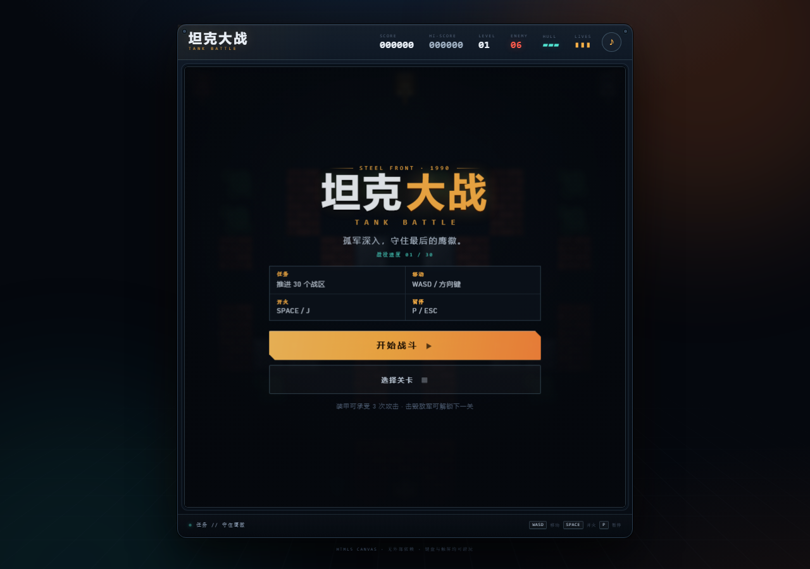
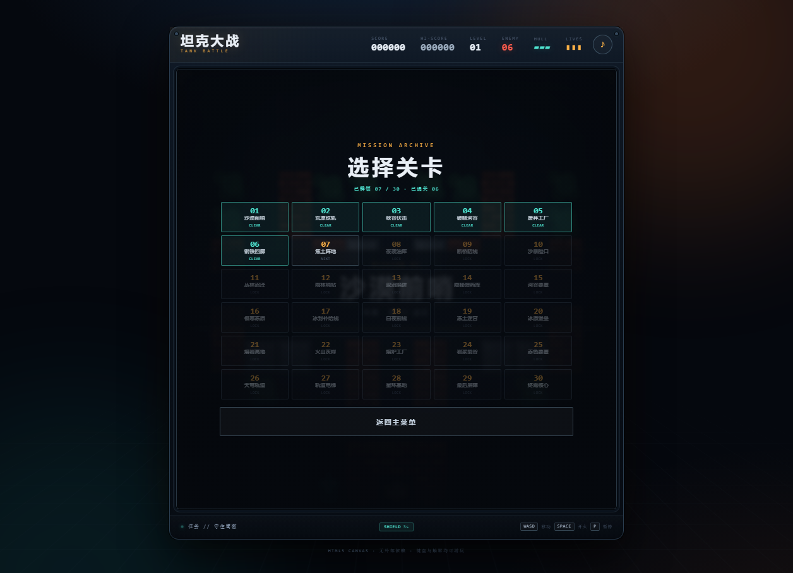
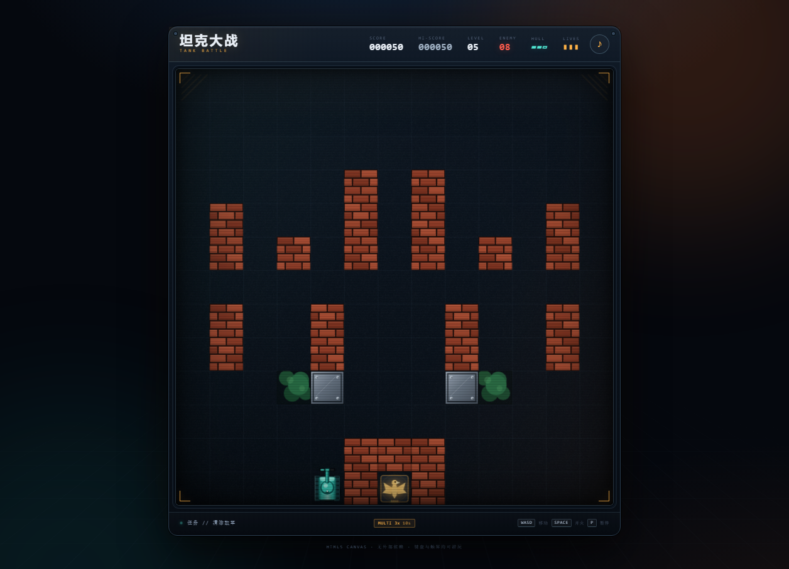
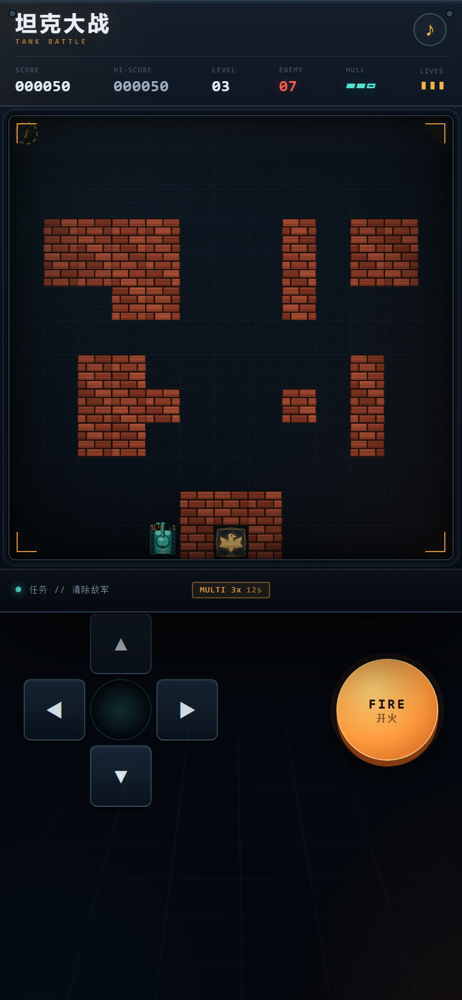

# 坦克大战 · TANK BATTLE

一个无需构建、打开即玩的 HTML5 Canvas 坦克大战。复古街机视觉、纯合成音效，支持键盘与触屏。**30 个战区、6 种道具、每辆坦克 3 格装甲**，敌军数量、装甲、射速、弹速与 AI 侵略性随关卡逐步提升。

**[在线试玩](https://sidhxy.github.io/tank-battle/)** · **[GitHub 仓库](https://github.com/sidhxy/tank-battle)**

<p align="center">
  
  
</p>

<p align="center">
  
</p>

<p align="center">
  
</p>

## 玩法

驾驶孤军深入的坦克，守住地图底部的鹰徽基地，推进 30 个战区。砖墙可以被炮弹摧毁，钢板不可穿透，河流阻挡坦克但炮弹能飞过，树林会遮挡视线。

- **30 个关卡 / 6 个战区**：荒漠、工厂、雨林、冻原、火山、天穹。每关敌军总数、同时在场数量、装甲厚度、射速、弹速和追击欲望都会提升。
- **3 种敌军**：轻型 `grunt`、快速 `scout`、重装 `armor`。重装敌军基础 3 格装甲，高关卡还会额外增加装甲，需要更多命中才能击毁。
- **每命 3 格装甲**：HUD 的 `HULL` 显示当前装甲；每次被敌方炮弹命中损失 1 格，3 次命中后才会损失一条命。重生后有短暂护盾。
- **6 种道具**：护盾 8s、急速射击 10s、**三连发 12s**、额外生命、全屏轰炸、时间冻结 5s。
- **三连发**：拾取后每次开火同时发射 3 枚扇形炮弹，持续 12 秒；与急速射击叠加时火力更强。
- **关卡选择**：主菜单、暂停界面和结算界面都能进入关卡选择；完成当前关卡后解锁下一关，进度自动保存。
- **基地防线**：鹰徽被击毁或生命耗尽都会结束游戏。
- **街机反馈**：屏幕震动、粒子爆炸、浮动得分、CRT 扫描线与复古合成音效。
- **本地记录**：最高分与关卡解锁进度使用 `localStorage` 保存。

## 操作

| 操作 | 键盘 |
| --- | --- |
| 移动 | `W` `A` `S` `D` / 方向键 |
| 开火 | `Space` / `J` |
| 暂停 / 继续 | `P` / `Esc` |
| 静音 | `M` |
| 触屏 | 屏幕下方方向键 + `FIRE` |

## 难度曲线

每关由同一套规则程序化生成，但数值逐关递增：

| 项目 | 第 1 关 | 第 30 关 |
| --- | --- | --- |
| 敌军总数 | 6 | 26 |
| 同时在场 | 4 | 8 |
| 重装敌军装甲 | 3 | 7 |
| 敌军射速倍率 | 1.0 | 约 1.46 |
| 敌军弹速 | 285 | 约 395 |
| 追击侵略性 | 0.03 | 约 0.06 |

地图使用固定种子与保底通路生成，保证出生点、主通道与基地之间始终连通。

## 本地运行

项目是纯静态页面，不需要安装依赖或构建：

```bash
# 方式一：直接双击 index.html

# 方式二：起一个本地静态服务器（推荐）
python -m http.server 8080
# 浏览器打开 http://localhost:8080
```

## 项目结构

```text
tank-battle/
├── index.html          # 街机外壳、HUD 与菜单/触屏 UI
├── css/
│   └── style.css       # 复古街机视觉、CRT 效果与响应式布局
├── js/
│   └── game.js         # 游戏循环、30 关生成、AI、碰撞、音效与渲染
├── assets/
│   └── favicon.svg
├── docs/               # README 展示截图
├── LICENSE
└── README.md
```

技术栈只有原生 HTML、CSS、JavaScript 和 Canvas 2D，没有外部字体、图片或运行时依赖。

## 部署到 GitHub Pages

1. 打开仓库的 **Settings → Pages**。
2. **Source** 选择 **Deploy from a branch**。
3. 分支选择 `main`，目录选择 `/ (root)`，保存。
4. 等待 Actions 完成，访问 <https://sidhxy.github.io/tank-battle/>。

## 存档键

| Key | 内容 |
| --- | --- |
| `tank-battle-hi` | 最高分 |
| `tank-battle-progress` | `{ unlocked, cleared }` 关卡解锁与通关记录 |
| `tank-battle-muted` | 静音状态 |

## License

[MIT](LICENSE) © 2026 sidhxy
